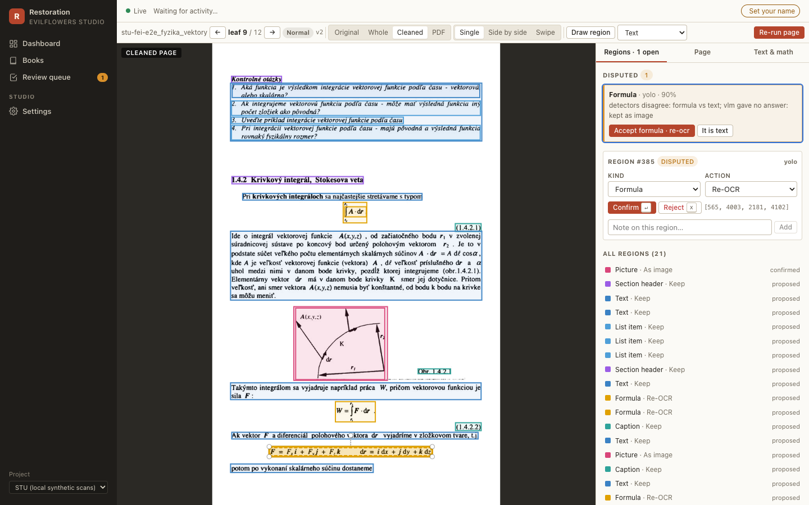
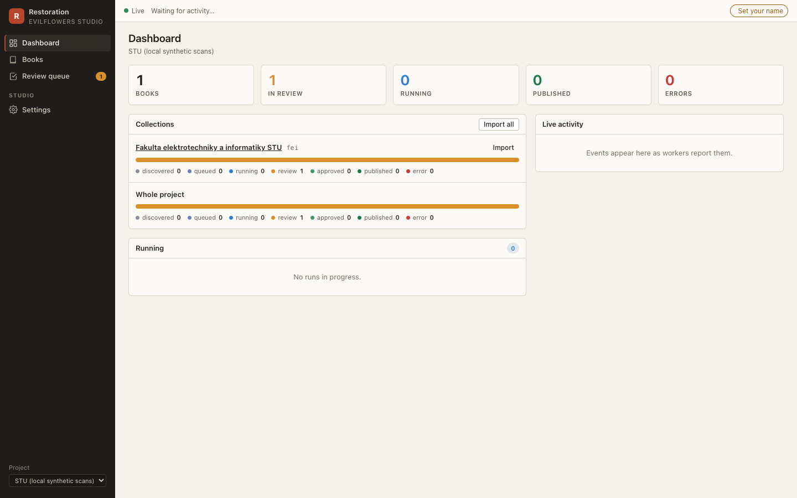
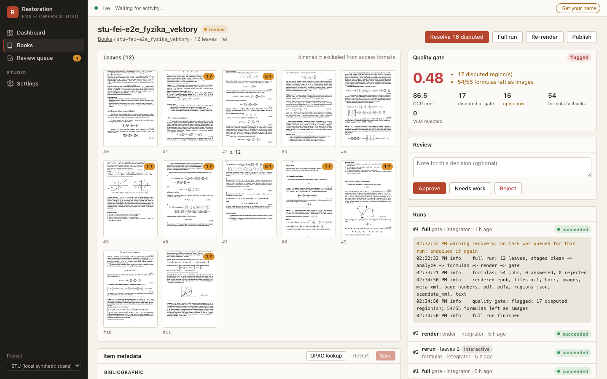
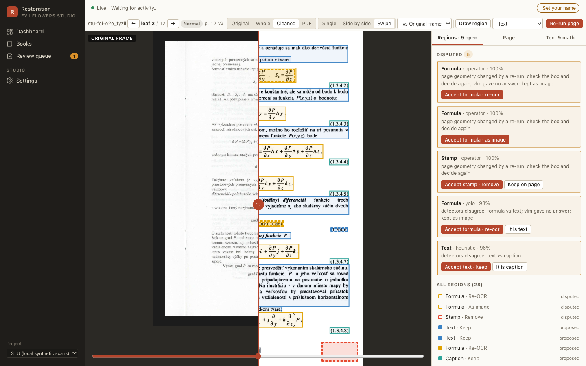
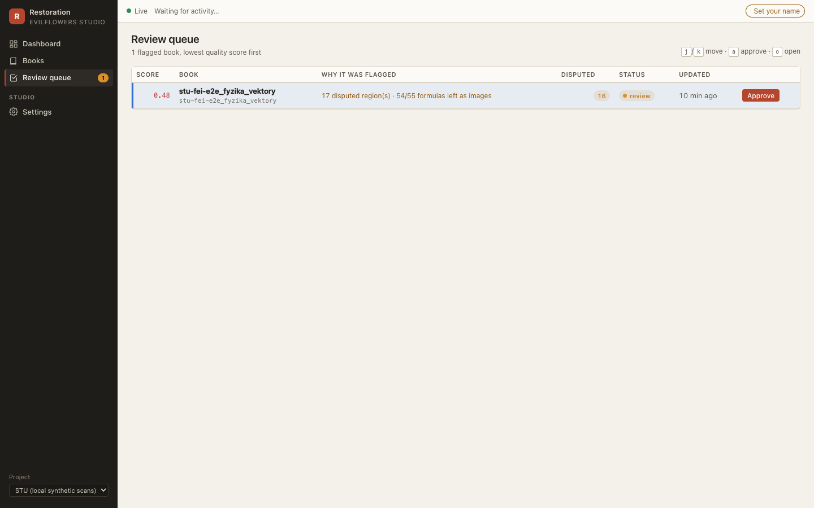

# EvilFlowers Restoration Studio

[](https://github.com/EvilFlowersCatalog/evilflowers-books-digitalizer/actions/workflows/tests.yml)
[](https://github.com/EvilFlowersCatalog/evilflowers-books-digitalizer/actions/workflows/docker.yml)
[](https://evilflowerscatalog.github.io/evilflowers-books-digitalizer/)

📖 **Documentation:** <https://evilflowerscatalog.github.io/evilflowers-books-digitalizer/>



A reusable studio for restoring scanned books. Workers turn raw TIFF scans into
cleaned pages, OCR, layout regions, a distribution PDF, a PDF/A-2b master and an EPUB;
operators review in the browser only what the machine was unsure about, and every book
becomes an **Internet Archive "texts" item** that is published to the
[EvilFlowers Catalog](https://github.com/EvilFlowersCatalog/EvilFlowersCatalog).

**Why.** Batch OCR of 880 scanned university books gets most pages right and some badly wrong:
stamps over text, formulas read as prose, crops that lose a column. A pure batch
pipeline can only rerun everything; a studio lets a person fix one region on one page,
re-run that page in seconds, and approve the book. Everything that varies between
libraries (scan layout, identifiers, detectors, publishing) is project configuration,
so the same studio serves other collections.

## Features

- **Pipeline as workers.** Spread splitting, ScanTailor cleaning, Tesseract OCR, layout
  detection (heuristic; DocLayout-YOLO behind config), formula recognition (PaddleOCR-VL
  behind config), MRC rendering with archive-pdf-tools, PDF/A-2b, and a reflowable EPUB.
  Celery queues `interactive` / `cpu` / `ai` / `io`.
- **Quality gate.** OCR confidence, disputed regions, formula fallbacks and missing pages
  give a score; books that fail go to a review queue, the rest are approved (and
  optionally published) automatically.
- **Page studio.** Deep-zoom viewer with original / spread / cleaned / PDF layers,
  side-by-side and swipe compare, region rectangles coloured by kind, one-click decisions
  on disputed regions, overrides (crop, deskew, split, despeckle, colour mode, OCR
  language), LaTeX editing with a live preview, and an interactive re-run of one page.
- **Live.** Server-sent events drive every screen; nothing polls while the stream is up.
- **IA compatible.** `_meta.xml`, `_scandata.xml`, `_page_numbers.json`, `_files.xml`,
  `_jp2.zip`, `_hocr.html`, `_djvu.txt`: the output tree *is* an IA item, and the IA
  export zip unpacks into one.
- **Catalog publishing** through `evilflowers-protocol`, idempotent: a republish updates
  the same entry and records a new version.
- **Training data.** Confirmed regions export as COCO / DocLayNet JSON with crops.

| | |
|---|---|
|  |  |
|  |  |

## Architecture

```
 SPA (React, OpenSeadragon, Annotorious)
   │  REST /api/v1 + SSE /api/v1/events + Deep Zoom tiles
   ▼
 studio/api (FastAPI) ── studio/application (use cases, one transaction each)
   │ enqueue studio.run                         │ SQLAlchemy
   ▼                                            ▼
 Redis (Celery broker + event bus) ◄──── Postgres (books, pages = IA leaves, regions,
   │                                            runs, reviews, notes, publications)
   ▼
 studio/workers (Celery: discover, run, clean, analyze, formulas, render, gate, publish)
   │ ports (studio/ports.py)
   ▼
 studio/adapters: scans · artifacts (IA tree) · imaging (ScanTailor, Pillow) · ocr
                  layout · formula · render (pipeline/steps, reflow) · metadata
                  catalog (EvilFlowers) · ia (meta/scandata/page_numbers/files, zip)
```

The use cases depend only on the domain, the ports and the events; adapters implement
the ports and reuse the batch pipeline's steps (`pipeline/steps`, `reflow/`,
`catalog/`) rather than copying them. The binding contract is
[docs/design/studio-spec.md](docs/design/studio-spec.md); the diagrams are
[component](docs/design/component-restoration-studio.puml),
[deployment](docs/design/deployment-restoration-studio.puml),
[ingest sequence](docs/design/sequence-restoration-ingest.puml) and
[review sequence](docs/design/sequence-restoration-review.puml).

## Quick start (dev stack)

Needs the system tools from [Setup](#setup) (Tesseract, `scantailor-deviant-cli`,
`jbig2enc`, `jpegoptim`, `qpdf`, pandoc), Docker for Postgres + Redis, and Node 20+ with
pnpm for the SPA.

```bash
uv sync                                                   # or: poetry install
docker compose -f deploy/dev/compose.yml up -d            # Postgres :55432, Redis :56379
export STUDIO_CONFIG=$PWD/configs/studio.dev.toml         # project stu-local
pnpm --dir frontend install && pnpm --dir frontend build  # SPA -> frontend/dist

evilflowers-digitalizer studio migrate                    # schema
evilflowers-digitalizer studio serve --port 8000          # API + SPA: http://127.0.0.1:8000
evilflowers-digitalizer studio worker -Q interactive,cpu,ai,io
```

Then **Import** on the dashboard, open a book and click **Full run**. Point
`scans_root` in `configs/studio.dev.toml` at your own scan tree first. The operator
workflow is in [docs/studio.md](docs/studio.md), the screens in
[docs/web_ui.md](docs/web_ui.md), and the split-process setup (one worker per pool,
`pnpm dev` with hot reload) in [deploy/dev/README.md](deploy/dev/README.md).

Measured on the synthetic 6-frame book (12 leaves) on a laptop: a full run takes about
2 minutes, an interactive page re-run about 5 seconds, and the IA export is 32 MB.

CLI: `evilflowers-digitalizer studio serve | worker | import | run | export-ia |
export-training | migrate`.

## Internet Archive compatibility

`books.item_id` is a permanent, IA-valid identifier (`ProjectConfig.item_identifier()`),
and every artifact is named after it. Book metadata follows `_meta.xml` (IA field names,
repeatable fields as lists, MARC language codes, `evilflowers_` custom fields). One
`pages` row is one IA *leaf* with scandata semantics (`pageType`, `handSide`,
`addToAccessFormats`, `cropBox`, printed page number); only `add_to_access` decides what
goes into the PDF and EPUB. The output tree under
`<artifacts_root>/<project>/<item_id>/` uses IA file names, so `ia upload`,
archive-pdf-tools, hocr-tools and BookReader work on it directly, and
`GET /api/v1/books/{id}/export/ia` (or `studio export-ia`) builds the item zip. Details:
[studio-spec, "Internet Archive compatibility"](docs/design/studio-spec.md#internet-archive-compatibility-mandatory).

## Deployment

One image (`Dockerfile`) runs the API and every worker pool; the container command picks
the role, and the SPA is built into it. Kubernetes manifests (kustomize base + dev
overlay, namespace `digitalizer`) are in [deploy/k8s/](deploy/k8s/README.md): `studio-api`
with a migrating init container and `/healthz` probes, `worker-cpu`, `worker-ai`,
`worker-io` (with beat), NFS volumes for the read-only scans and the output tree, and
secrets from `studio-secrets`. The config is `configs/studio.k8s.toml`.

```bash
kubectl kustomize --load-restrictor=LoadRestrictionsNone deploy/k8s/overlays/dev
```

---

# Classic batch pipeline

The studio grew out of this unattended batch pipeline, which still works on its own:
TIFF scans → **two PDFs per book** (a fast **distribution** copy and a **PDF/A-2b
archival** master) with Slovak OCR, metadata and covers, imported into the catalog.
Built entirely on OSS tooling (Tesseract, ScanTailor, archive-pdf-tools, pikepdf,
webdav4).

## Pipeline architecture

Scans are **two-page spreads on a black scanner bed** (uncompressed RGB TIFF @ 300
DPI, ~24 MB/frame). Frames are read by a pluggable **source** (a local mount in
production, WebDAV in dev — `[source]` in `configs/pipeline.toml`). One OCR pass
feeds a profile-driven renderer that emits **one PDF per output profile**:

```
source (TIFF frames per book)        output/distribution/<source>/<slug>.pdf,.txt,.cover.jpg
        │                                   output/archival/<source>/<slug>.pdf  (PDF/A-2b)
        ▼                                                          ▲
  DownloadBook ─► [AttachMetadata] ─► ScanTailorScans ─► [DocResEnhance]
  (stage to        (Excel catalog)     (split at gutter,  (optional AI
   local cache)                         deskew, margins)   appearance)
        │
        ▼
  [DetectLanguage] ─► OcrPages ─────► RenderPdf ──────────► EnrichPdfMetadata
   (langdetect)       (Tesseract       (recode_pdf MRC,      (XMP into the
                       -> hOCR + txt)   one PDF per profile)  non-PDF/A copies)
        │
        ▼
  [GenerateCover] ─► FinalizePdf ──────► EnsurePdfA ─────► [WriteCatalogManifest]
   (thumbnail)       (merged bookmarks,  (declare archival   (entry.json for the
                      page labels,        as PDF/A-2b,        distribution copy)
                      linearize dist.)    veraPDF-validated)
```

**Output profiles** (`[render]`, presets in `pipeline/profiles.py`):

| profile | encoding | for | notes |
|---|---|---|---|
| `distribution` | **JPEG (DCTDecode)** MRC, bg↓3 fg↓2, linearized | readers, the catalog | opens fast in every viewer; ~7× faster to decode than JPEG2000 |
| `archival` | **JPEG2000** MRC → **PDF/A-2b** | preservation master | compact; opened rarely |

Text stays razor-sharp in both — the JBIG2 1-bit mask is full resolution; only
the colour layers downsample. (The old single output used 26-MP JPEG2000 layers
that rendered blank/slow in Preview and PDF.js — fixed by the JPEG distribution
copy. See `notebooks/03_dual_output_lab.ipynb`.)

**Output layout** (`[render] layout`): `split` (default) separates the trees —
`<output>/distribution/<faculty>/<slug>.pdf` (+ sidecars/cover) and
`<output>/archival/<faculty>/<slug>.pdf` — so access copies can be served and
masters cold-stored independently. `flat` instead writes both PDFs next to the
sidecars as `<slug>.<profile>.pdf`. Unreadable/truncated source frames are
skipped (recorded in the report's `skipped_frames`) rather than failing the book.

Each step implements `PipelineStep.run(ctx: BookContext) -> BookContext`; a
`Pipeline` is an ordered list of steps, so planned stages (classification,
embeddings on the OCR text sidecar) and new outputs (a new `PdfProfile`) slot in
without touching existing code. `pipeline.factory.build_pipeline` wires it from
`configs/pipeline.toml`.

The empirical basis for the settings is in
[docs/digitalization_pipeline_report.md](docs/digitalization_pipeline_report.md)
and reproducible in `notebooks/03_dual_output_lab.ipynb`.

## Setup

The pipeline shells out to system tools (Tesseract OCR, `scantailor-deviant-cli`,
`jbig2enc` for the MRC text mask, **`jpegoptim`** for the JPEG distribution PDF,
and `qpdf` for linearization). Install those for your platform, then the Python
package. Or skip the host install entirely and use
**[Docker](#docker-full-toolchain)**, which bakes in the full toolchain.

### 1. System dependencies

**macOS (Homebrew)**

```bash
brew install tesseract tesseract-lang               # required (OCR)
brew install jbig2enc jpegoptim qpdf                # MRC mask + JPEG output + linearize
brew install verapdf                                # optional: PDF/A-2b validation
brew install pandoc potrace hunspell                # optional: [reflow] EPUB edition
```

**Ubuntu / Debian (apt)**

```bash
sudo apt update && sudo apt install -y \
  tesseract-ocr tesseract-ocr-slk tesseract-ocr-ces tesseract-ocr-eng \
  jbig2enc jpegoptim qpdf
```

`scantailor-deviant-cli` has no distro/brew package on either platform. Build it
from source (recipe in the [Dockerfile](Dockerfile)) and drop the binary in
`~/.local/bin`, or use Docker. Then verify Tesseract has the Slovak pack:

```bash
tesseract --list-langs | grep slk
```

### 2. Python package

With [uv](https://docs.astral.sh/uv/) (recommended) or Poetry:

```bash
git clone https://github.com/EvilFlowersCatalog/evilflowers-books-digitalizer.git
cd evilflowers-books-digitalizer
uv sync                                             # or: poetry install
cp credentials.example.toml credentials.toml        # WebDAV creds (dev/webdav source only)
```

Run the operator CLI:

```bash
uv run evilflowers-digitalizer --help               # or: poetry run … / python -m evilflowers_books_digitalizer …
```

**Try the CLI without cloning** — `uvx` runs it straight from the public repo (you
still need the system tools above and a `configs/pipeline.toml` in the working dir):

```bash
uvx --from git+https://github.com/EvilFlowersCatalog/evilflowers-books-digitalizer \
  evilflowers-digitalizer --help
```

### Docker (full toolchain)

The image bakes in *everything* the `scantailor_mrc` engine needs —
`scantailor-deviant-cli`, `jbig2enc`, Tesseract + language packs, and the optional
DocRes model — so no host install is required:

```bash
docker build -t evilflowers-digitalizer .            # --build-arg DOCRES_WEIGHTS=0 to skip ~900 MB
docker run --rm --user "$(id -u):$(id -g)" \
  -v /mnt/digital-library/raw-scans:/mnt/digital-library/raw-scans:ro \
  -v $PWD/configs:/app/configs:ro \
  -v $PWD/output:/app/output -v $PWD/.cache:/app/.cache \
  evilflowers-digitalizer \
  evilflowers-digitalizer run-book fad '<BOOK_ID>'
```

The image runs as a non-root user and reads its config from
`$EVILFLOWERS_DIGITALIZER_CONFIG` (default `/app/configs/pipeline.toml`); relative
paths in a config resolve against the config file's directory. Env vars, exit
codes and JSON logs: [docs/deployment.md](docs/deployment.md).

> **DocRes (optional AI enhancement).** On Apple Silicon the host MPS path is far
> faster than the container's CPU; it lives in `~/.local/share/evilflowers-tools/`
> (DocRes repo + venv + weights), configured under `[docres]` in `pipeline.toml`.

## Production (local mount, plain runner)

For unattended multi-TB runs on a VM, the scans are a **local mount**
(`/mnt/digital-library/raw-scans`), books are enriched from an **Excel catalog**,
and each gets a **cover thumbnail** (real OPAC cover by ISBN, else generated). The
batch is a single long-running process — no orchestrator. Progress and every path
land in a small database (SQLite by default, fail-safe).
Optionally each book also gets a reflowable **EPUB edition** (`[reflow]`).
Configure everything in `configs/pipeline.toml`.

```bash
evilflowers-digitalizer <command>        # or: python -m evilflowers_books_digitalizer <command>
  check [--catalog]          # preflight: mounts, writable dirs, disk, binaries [, catalog]
  list svf                   # books on a source
  validate-catalog           # Excel match/miss report across sources
  preview-cover svf <id>     # render one cover to iterate on style
  run-book svf <id> [<id>…] [--publish]   # books end to end, one after another
  run-source svf --limit 3 [--publish]    # a faculty (process pool)
  run-corpus                 # the whole corpus
  monitor                    # live TUI dashboard (progress, throughput, ETA)
  stats                      # snapshot table (--json | --export csv|json|html)
  publish-book svf <id>… [--dry-run] [--force]   # import given books into EvilFlowers Catalog
  publish-catalog            # import all produced books (resumable)
  db upgrade | import        # migrate the processing DB / record already-produced books
  studio …                   # the Restoration Studio (see the top of this README)
```

`--config` is optional when `EVILFLOWERS_DIGITALIZER_CONFIG` is set;
`EVILFLOWERS_LOG_FORMAT=json` switches stderr to JSON lines.

Run it under screen / systemd / Docker — see `deploy/` and:

- [docs/testing.md](docs/testing.md) — **end-to-end testing & go-live runbook** (start here)
- [docs/architecture.md](docs/architecture.md) — components and data flow
- [docs/deployment.md](docs/deployment.md) — production config + go-live
- [deploy/README.md](deploy/README.md) — run (screen/systemd/Docker) + monitoring
- [docs/operations.md](docs/operations.md) — monitoring, resume, disk, tuning
- [docs/metadata_and_covers.md](docs/metadata_and_covers.md) — Excel mapping + cover sourcing
- [docs/catalog_import.md](docs/catalog_import.md) — manifest → Catalog REST import
- [docs/studio.md](docs/studio.md) — Restoration Studio operator guide
- [docs/web_ui.md](docs/web_ui.md) — Studio UI screens, live updates, processing database
- [docs/reflow_edition.md](docs/reflow_edition.md) — the born-digital EPUB edition

## Notebooks

Experimentation happens in notebooks first; the module holds the reusable parts.
Every notebook shares the **single cache + output root** via `load_runtime()` —
no notebook hardcodes its own scratch dir. Install the notebook dependencies
(`poetry install --with notebooks`), then `poetry run jupyter lab`.

| Notebook                          | Purpose                                                                  |
|-----------------------------------|--------------------------------------------------------------------------|
| `01_explore_corpus.ipynb`         | Survey sources + the local cache; inspect a raw frame                    |
| `02_clean_pages_lab.ipynb`        | ScanTailor cleaning lab: before/after, knobs                             |
| `03_dual_output_lab.ipynb`        | **The encoder experiment**: JPEG vs JPEG2000, size + decode time, PDF/A, alternatives |
| `04_single_book_e2e.ipynb`        | Full production pipeline on one cached book; inspect both PDFs           |
| `05_batch_pipeline.ipynb`         | Batch over books (resumable, low-storage, monitor)                       |
| `06_metadata_and_covers.ipynb`    | Metadata draft + ISBN enrichment + cover preview                         |
| `07_stats_and_results.ipynb`      | Stats dashboard over `output/`: coverage, sizes, throughput              |

Programmatic use:

```python
from evilflowers_books_digitalizer import BookContext, LocalCache, build_source
from evilflowers_books_digitalizer.pipeline.factory import build_pipeline
from evilflowers_books_digitalizer.runtime import build_catalog, load_runtime

rt = load_runtime()                                  # single cache + output root
cache = LocalCache(rt.cache_dir)
source = build_source(rt.source, "svf")
pipeline = build_pipeline(source, cache, config=rt.config, catalog=build_catalog(rt.metadata))

ctx = pipeline.run(BookContext(
    source="svf", book_id="<book-dir>",
    work_dir=cache.book_dir("svf", "<book-dir>"),
    output_dir=rt.output_dir / "svf",
))
print(ctx.artifacts["pdf_distribution"], ctx.artifacts["pdf_archival"])
```

## Layout

```
evilflowers_books_digitalizer/
├── config.py             settings + credentials.toml loading
├── runtime.py            resolves pipeline.toml -> paths, source, catalog
├── models.py             BookRef, PageScan, SourceStats
├── cache.py              LocalCache — scans & cached stats layout
├── batch.py              process_book — one book, low-storage, isolated
├── cli.py                operator CLI (python -m evilflowers_books_digitalizer)
├── sources/              AbstractBookSource + filesystem (mount) / webdav backends
├── metadata/             Excel catalog matched to books by directory name
├── covers/               PIL cover renderer, templates, palettes, bundled fonts
├── catalog/              import layer: book -> EvilFlowers Catalog entry (manifest + REST)
├── studio/               Restoration Studio: domain, ports, events, metadata, config,
│                         application (use cases), api (FastAPI), workers (Celery), adapters
├── reflow/               EPUB reflow edition (layout analysis, anchoring, VLM sidecar)
├── db/                   SQLAlchemy models + Alembic migrations
├── runner.py             run_source / run_corpus — process-pool batch (no orchestrator)
├── reporting.py          summarize the JSONL reports (powers stats)
├── progress.py           per-book heartbeats (live parallel-worker view)
├── dashboard.py          shared rich table for monitor + stats
├── exports.py            stats exports (per-book CSV, summary JSON, HTML report)
├── monitor.py            live rich TUI dashboard
└── pipeline/
    ├── base.py           BookContext, PipelineStep, Pipeline
    ├── factory.py        build_pipeline (imaging → render → enrich → finalize → pdfa tail)
    ├── profiles.py       PdfProfile + DISTRIBUTION / ARCHIVAL presets
    ├── hocr.py           shared hOCR parser (OCR sidecar + finalize bookmarks)
    ├── pdfa.py           lossless PDF/A-3b → 2b re-declaration + veraPDF validation
    └── steps/            download, scantailor, ocr, render, enrich, cover, finalize, pdfa, …
configs/pipeline.toml     production config (source, metadata, cover, orchestration)
configs/studio.*.toml     studio configs: dev (synthetic scans) and k8s
frontend/                 the studio SPA (React + TypeScript + Vite)
configs/catalog.xlsx      bibliographic metadata (you provide)
deploy/                   batch (systemd, compose, runbook); studio dev stack + k8s manifests
docs/                     studio guide + spec, architecture, deployment, operations, metadata & covers
notebooks/                exploration & experimentation
credentials.toml          WebDAV secrets (gitignored; not needed for the mount backend)
.cache/                   staged scans + share stats (gitignored)
output/                   produced PDFs / text / covers (gitignored)
```
