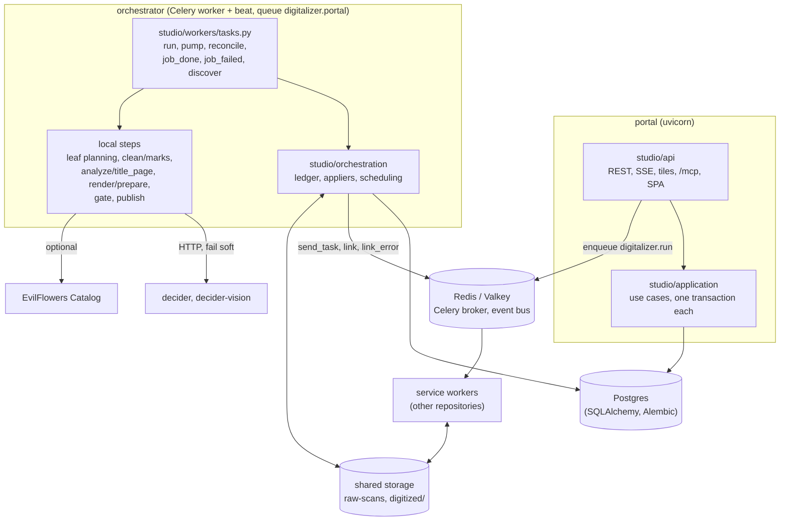
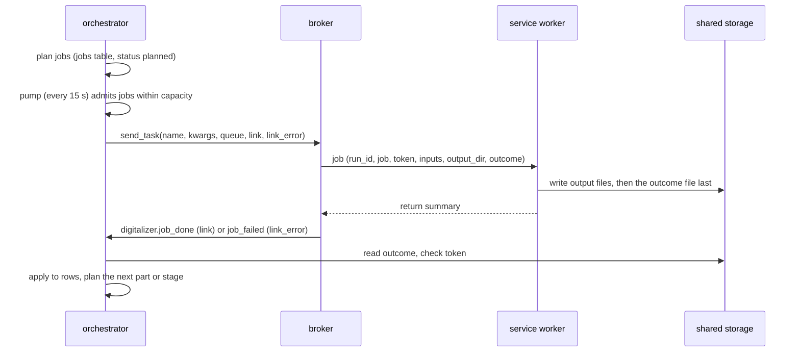

# Architecture

The repository is a **portal**, an **orchestrator** and a **lab**. The design and its
decisions are in [design/target-architecture.md](design/target-architecture.md). This page
describes what the code does today.

## Parts

| Path | Responsibility |
|---|---|
| `studio/domain.py`, `ports.py`, `events.py`, `metadata.py`, `config.py` | vocabulary, rules (`fuse`, `quality_gate`), interfaces, IA metadata model, TOML config |
| `studio/application/` | use cases: books, pages, regions, runs, review, scheduler, marks, title page, labelling, export |
| `studio/api/` | FastAPI app: REST (`/api/v1`), SSE, Deep Zoom tiles, MCP at `/mcp`, the SPA |
| `studio/workers/` | Celery app (one queue), tasks, the orchestrator's half of each stage (`stages/`) |
| `studio/orchestration/` | job ledger, the service contract (`contract.py`), appliers, admission (`scheduling.py`) |
| `studio/adapters/` | scan store, IA artifact store and exporter, spread planner and tiles, metadata providers, catalog publisher, decider client |
| `studio/marks.py`, `studio/title_page.py` | pure rules for scan-mark groups (#14) and title-page candidates (#15) |
| `metadata/`, `catalog/` | Excel / OPAC / OCR metadata lookup; book metadata to catalog entry mapping |
| `db/` | SQLAlchemy models and Alembic migrations (head: `0007_marks_title_page`) |
| `studio/testing/` | stand-in services and engine doubles, used by the tests |

The dependency rule: `domain.py` imports nothing from the project; `application/` imports only
the domain, ports, events, metadata, config and the session; adapters implement ports; the API
and the workers wire adapters into use cases.

## Stages and where they run

| Stage | Jobs | Runs on |
|---|---|---|
| clean | `evilflowers_scan.clean`, then the local `marks` step | scan-service, orchestrator |
| analyze | `evilflowers_ocr_worker.standalone.hocr` and `evilflowers_analyzer.standalone.layout` per leaf batch, in parallel; `evilflowers_scan.erase` for leaves with confirmed `remove` boxes; then the local `title_page` step | ocr-service, analyzer-service, scan-service, orchestrator |
| formulas | `evilflowers_equation.standalone.formulas` | equation-service |
| render | the local `prepare`, then `evilflowers_render.book` | orchestrator, render-service |
| gate | `digitalizer.local.gate` | orchestrator |
| publish | `digitalizer.local.publish` | orchestrator |

The stage lists per run kind are `STAGES` in `studio/workers/stages/orchestrate.py`:

| Run kind | Stages |
|---|---|
| `full` | clean, analyze, formulas, render, gate |
| `rerun` | clean, analyze, formulas |
| `render` | render |
| `publish` | publish |

Rules about parts (`studio/config.py`):

- `SPLIT_STAGES`: analyze runs `hocr` and `layout` in parallel on every leaf batch.
- `CHAINED_STAGES`: render runs `prepare`, then `book`, one job each.
- `TAIL_PARTS`: a local step planned once after every other job of the stage is applied
  (`clean` then `marks`, `analyze` then `title_page`). `_next_part` in
  `studio/orchestration/ledger.py` plans it.
- A leaf-batched stage sends 32 leaves per bulk job and one leaf per interactive job
  (`batch`, `interactive_batch`).
- `backend = "local"` for clean, analyze, formulas or render is rejected at load time.

The orchestrator does only light work itself: spread detection on the raw frames
(`studio/adapters/imaging/spreads.py`, OpenCV), the metadata lookup and item text files in
`render/prepare`, the grouping in `clean/marks`, the candidates in `analyze/title_page`, the
gate and publication. All pixel and model work is on the services.

## The job ledger

- Job states: `planned`, `dispatched`, `started`, `applied`, `failed`, `revoked`
  (`JobStatus` in `studio/domain.py`).
- Each attempt of a job has its own token and its own output directory
  (`<item>/<item>_studio/jobs/<job id>-a<attempt>/`). An outcome whose run or token does not
  match the current attempt is refused (`contract.read_outcome`), so a lost or superseded
  attempt cannot overwrite newer work.
- No result backend and no event listener: the callbacks are ordinary messages on
  `digitalizer.portal`.
- `digitalizer.reconcile` (every 60 s) applies an outcome file that exists without a callback.
  Otherwise it puts a job with no outcome by its deadline back to `planned` with a new token
  (so it passes admission again) and revokes the old message. When the job's `budget`
  (`[orchestration] budget`, default 2) is spent, the job and its run fail.
- Service jobs carry paths relative to the storage root, so a service may mount the storage
  elsewhere. Only the layout below the root must match.

State diagrams: [book](diagrams/state-digitalizer-book.svg),
[run and job](diagrams/state-digitalizer-run-job.svg). Sequences:
[full run](diagrams/sequence-digitalizer-full-run.svg),
[page re-run](diagrams/sequence-digitalizer-page-rerun.svg),
[clean](diagrams/sequence-digitalizer-clean-service.svg),
[analyze](diagrams/sequence-digitalizer-analyze-service.svg),
[formulas](diagrams/sequence-digitalizer-formulas-service.svg),
[render](diagrams/sequence-digitalizer-render-service.svg),
[scan marks](diagrams/sequence-digitalizer-scan-marks.svg),
[title page](diagrams/sequence-digitalizer-title-page.svg).

## Admission

Book digitalization is background work. The pump (`studio/orchestration/scheduling.py`) sends
bulk jobs only within the current capacity, set by `[scheduling]`:

| Mode | Meaning |
|---|---|
| `normal` | `bulk_inflight` jobs |
| `peak` | `bulk_inflight_peak` jobs during `peak_hours`; `off_peak_stages` (render) are held |
| `contended` | the queues of the `[[scheduling.backpressure]]` sources are deeper than `max_depth` |
| `paused` | an operator switch (`POST /api/v1/scheduler/pause`) |

Interactive re-runs (the `interactive` lane) are never held. `GET /api/v1/scheduler` shows the
mode and capacity.

## Regions and disputes

The analyze stage turns the analyzer-service's layout regions, the scan-service's stamp and
sticker marks and the operator's earlier decisions into regions with `domain.fuse()`. A region
is **disputed** when:

- overlapping proposals disagree in a way that changes the output (for example formula vs
  picture, stamp vs text);
- a lone proposal has a confidence below `min_confidence` (0.55);
- a stamp, sticker or handwriting region was only proposed by a machine (removing pixels needs
  a person's consent the first time);
- equation-service doubts its own answer (`disputed` and `reason` in `formulas.json`;
  `contract.FormulaAnswer`);
- a re-run changed the page geometry under a decided region.

Confirmed and rejected regions are kept across re-runs and win every fusion.

## Operator-facing decisions

Two book-wide features sit between the stages and ask a decision service
([docs/studio.md](studio.md#decision-services)):

- scan marks grouped across the book ([#14](studio.md#scan-mark-groups-14));
- title-page metadata prefill ([#15](studio.md#title-page-prefill-15)).

Both fail soft: a run never fails because a decision service is down.

## Storage

Everything lives under the storage root (`$STUDIO_STORAGE_ROOT`):

| Path | Content |
|---|---|
| `{storage_root}/raw-scans/` | the scan tree (read-only) |
| `{artifacts_root}/<project>/<item_id>/` | the IA item tree (`artifacts_root`, below the storage root, for example `{storage_root}/digitized/studio`); job output goes to `<item_id>_studio/jobs/<job>-a<n>/` and is applied into the item by the orchestrator |
| `cache_dir` | scratch: viewer renditions, tiles, label crops |

`load_config` fails when the storage root is missing or when the scans or the artifacts are
outside it.

## Notebooks and experiments

`lab/` holds the notebooks. They drove the retired batch pipeline; see
[lab/README.md](https://github.com/EvilFlowersCatalog/evilflowers-books-digitalizer/blob/master/lab/README.md).
