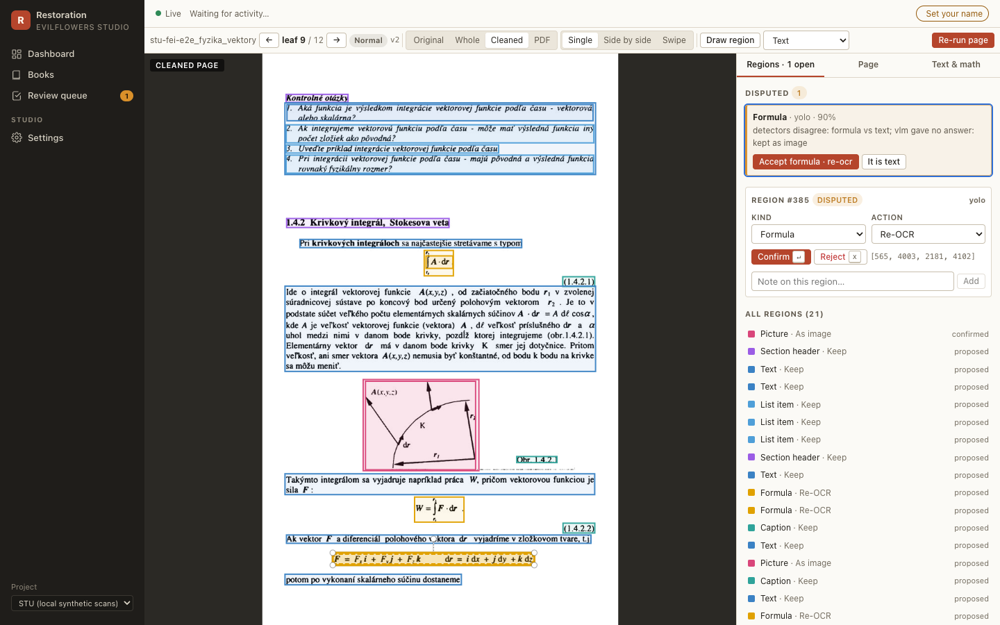

# EvilFlowers Restoration Studio

This repository is the **portal, the orchestrator and the lab** of the EvilFlowers book
digitalizer. It turns a tree of scanned TIFF frames into one Internet Archive "texts" item per
book (cleaned pages, hOCR, a distribution PDF, a PDF/A-2b master, an EPUB and the IA metadata
files). Operators review in the browser only what the machine was unsure about. A book can
then be published to the
[EvilFlowers Catalog](https://github.com/EvilFlowersCatalog/EvilFlowersCatalog).



It does not process pixels or run models itself. Each stage is a task on a standalone service
worker. This repository plans the jobs, sends them, applies the results and serves the review
UI.

!!! note "The batch pipeline is retired"
    The unattended batch pipeline and its CLI (`run-book`, `run-corpus`, `monitor`) were
    removed in evilflowers-books-digitalizer#6. The last commit that has them is `c94a858`.
    The pages that describe them are kept under [Archive](archive/digitalization_pipeline_report.md).

## How a book is processed

```mermaid
flowchart LR
    scans[("scans<br/>TIFF frames")] --> plan["plan leaves<br/>(orchestrator)"]
    plan --> clean["clean<br/>scan-service"]
    clean --> marks["clean/marks<br/>(orchestrator)"]
    marks --> analyze["analyze<br/>ocr + analyzer services"]
    analyze --> tp["analyze/title_page<br/>(orchestrator)"]
    tp --> formulas["formulas<br/>equation-service"]
    formulas --> prep["render/prepare<br/>(orchestrator)"]
    prep --> render["render<br/>render-service"]
    render --> gate{"quality gate"}
    gate -->|pass| approved["approved"]
    gate -->|flags| review["review queue"]
    review -->|operator approves| approved
    approved -.->|optional| publish["publish to catalog"]
```



Every service job is recorded in a job ledger and reported back through Celery callbacks.
A reconcile task re-sends lost jobs. The default task names and queues are in
`evilflowers_books_digitalizer/studio/config.py` (`DEFAULT_ROUTES`).

## Quick start

```bash
poetry install
docker compose -f deploy/dev/compose.yml up -d
export STUDIO_CONFIG=$PWD/configs/studio.dev.toml
evilflowers-digitalizer studio migrate
evilflowers-digitalizer studio serve --port 8000
evilflowers-digitalizer studio worker -- -B     # the orchestrator, with beat
```

Run the service workers you need from their own repositories on the same Redis. The full
steps are in [Testing & local run](testing.md) and in the
[dev stack README](https://github.com/EvilFlowersCatalog/evilflowers-books-digitalizer/blob/master/deploy/dev/README.md).

## Where to go next

| If you want to... | Read |
|---|---|
| Review and correct books in the web studio | [Restoration Studio guide](studio.md) |
| See the screens and keyboard shortcuts | [Studio UI](web_ui.md) |
| Understand the parts and the data flow | [Architecture](architecture.md) |
| See the design and its status | [Target architecture](design/target-architecture.md) |
| Implement against the API, data model or IA rules | [Studio spec](design/studio-spec.md) |
| Configure metadata sources (Excel, OPAC, OCR) | [Metadata](metadata.md) |
| Run it locally and check it | [Testing & local run](testing.md) |
| Deploy it and know its runtime contract | [Deployment](deployment.md) |
| Operate it: monitoring, resuming, troubleshooting | [Operations](operations.md) |
| Read about the retired batch pipeline | [Archive](archive/digitalization_pipeline_report.md) |
