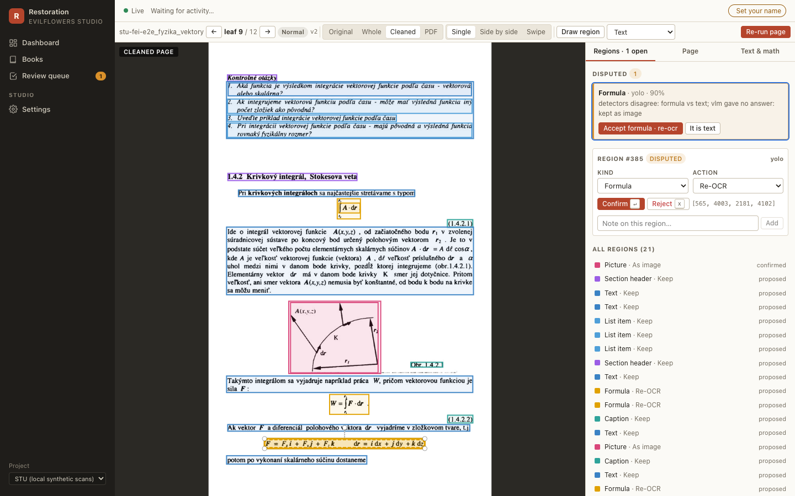

# Restoration Studio: operator guide

The studio turns a tree of scanned TIFF frames into an Internet Archive "texts" item per
book: cleaned page images, an hOCR text layer, a distribution PDF, a PDF/A-2b master, an
EPUB, and the IA metadata files. Workers do the heavy lifting in the background. The
operator steps in only where the machine is unsure: a region it could not classify, a
page that needs a different crop, or a book the quality gate flagged.

This guide follows one book from import to publication. The screens are described in
[Studio UI](web_ui.md); the contract between the parts is in
[design/studio-spec.md](design/studio-spec.md).



## 1. Start the studio

Locally, everything except Postgres and Redis runs from the repository's venv
(full commands in [deploy/dev/README.md](https://github.com/EvilFlowersCatalog/evilflowers-books-digitalizer/blob/master/deploy/dev/README.md)):

```bash
docker compose -f deploy/dev/compose.yml up -d                  # Postgres :55432, Redis :56379
export STUDIO_CONFIG=$PWD/configs/studio.dev.toml
evilflowers-digitalizer studio migrate                          # schema (alias of db-upgrade)
evilflowers-digitalizer studio serve --port 8000                # API + the built SPA
evilflowers-digitalizer studio worker -Q interactive,cpu,ai,io  # one worker, every queue
```

Build the SPA once with `pnpm --dir frontend install && pnpm --dir frontend build`; the API
serves it from `frontend/dist` at <http://127.0.0.1:8000>. For SPA development, `pnpm
--dir frontend dev` serves it on :5173 and proxies `/api` to the API.

There is no login: the studio is reachable only over the VPN. Click **Set your name** in
the top bar once. The name is kept in the browser and recorded on every note, review and
region edit.

## 2. Import a collection

A *project* (`[projects.<slug>]` in the studio config) says where the scans are and how
books are named:

| key | example | meaning |
|---|---|---|
| `scans_root` | `/data/raw-scans` | the read-only scan tree |
| `book_pattern` | `{collection}/*-skeny/{book}` | where a book's directory is; `{collection}` and `{book}` are captured |
| `frames_glob` | `stream_pages_tif/*.tif` | frames inside the book directory |
| `item_id` | `stu-{collection}-{book}` | the permanent IA identifier (lowercased, never renamed) |
| `auto_publish` | `never` / `gate` / `review` | when a book goes to the catalog by itself |

On the **Dashboard**, click **Import** next to a collection (or **Import all**). Discovery
runs on the `io` queue and adds one row per book in status `discovered`; nothing is read
except directory listings. From the CLI: `evilflowers-digitalizer studio import stu-local fei`.

## 3. Run a book

Open the book and click **Full run**. The run goes through five stages, each visible
live in the run log:

1. **clean**: spread detection decides the leaves once (two per spread, LEFT/RIGHT), then
   ScanTailor splits, deskews, crops and binarises each leaf; previews and Deep Zoom tiles
   are written.
2. **analyze**: Tesseract OCR plus the layout detectors (the heuristic by default,
   DocLayout-YOLO when configured) propose regions; `fuse()` merges them, and regions the
   detectors disagree on become **disputed**.
3. **formulas**: formula regions go to PaddleOCR-VL when `formula_recognizer` is
   `paddleocr-vl` (local tool venv) or `paddleocr-vl-http` (the `vlm` service, see
   [Formula recognition service](#formula-recognition-service)); with `none` they stay images.
4. **render**: the IA item files, the PDFs and the EPUB, from the access leaves only.
5. **gate**: the quality signals decide `approved`, or `review` with the flags listed.

On the synthetic 6-frame test book a full run takes about two minutes on a laptop: 12
leaves, 168 regions, OCR confidence 86, and the gate flags *"44/44 formulas left as
images"* because no formula recognizer is configured.

### Layout detectors

`layout_detectors` lists the detectors whose proposals `fuse()` merges. Two that disagree
are what turns a region **disputed**, so a second detector is worth its CPU time.

| name | what it is | needs |
|---|---|---|
| `heuristic` | the reflow analysis over hOCR and pixels, plus the blue-stamp mask | nothing |
| `doclayout` (alias `yolo`) | DocLayout-YOLO, DocStructBench classes, ONNX on CPU | `onnxruntime`, the model file |

The `doclayout` model is the ONNX export
[`wybxc/DocLayout-YOLO-DocStructBench-onnx`](https://huggingface.co/wybxc/DocLayout-YOLO-DocStructBench-onnx),
converted from `juliozhao/DocLayout-YOLO-DocStructBench`. Both model cards state
Apache-2.0. The metadata embedded in the graph still carries the Ultralytics AGPL-3.0
boilerplate of the training code. The studio uses only the weights, never that code.
Install the model once per worker:

```bash
mkdir -p ~/.local/share/evilflowers-tools/models/doclayout-yolo
curl -L -o ~/.local/share/evilflowers-tools/models/doclayout-yolo/doclayout_yolo_docstructbench_imgsz1024.onnx \
  https://huggingface.co/wybxc/DocLayout-YOLO-DocStructBench-onnx/resolve/main/doclayout_yolo_docstructbench_imgsz1024.onnx
# sha256 fece9af02f618b603ff7921ccec6861d13e7e1f9830e091dfb7e8ad9311e5b21
```

Settings live in `[projects.<p>.pipeline.layout]`: `model` (defaults to the path above),
`conf` (0.25), `iou` (0.5, per-class NMS), `imgsz` (1024) and `threads` (0 means all
cores). The model maps `abandon` (running heads, folios) to page header or footer by
position, and equation numbers (`formula_caption`) to caption. Only the ONNX graph is
loaded. The PyTorch `.pt` checkpoint is a pickle and the studio never opens it.

On an M1 Max a 600 dpi leaf takes about 1.2 s with all cores and 2.3 s with two threads.
On the 12-leaf test book the two detectors produced 237 regions, 12 of them disputed.

### Formula recognition service

In k8s the nodes have no GPU, so PaddleOCR-VL-1.6 (0.9 B, Apache-2.0) runs on CPU as its
own Deployment, `vlm` (`evilflowers_books_digitalizer/vlm_service`, Dockerfile target
`vlm`, weights baked in at a pinned Hugging Face revision). worker-ai's `studio.formulas`
calls it with `formula_recognizer = "paddleocr-vl-http"`:

```toml
[projects.stu.pipeline.vlm]
url = "http://vlm.digitalizer.svc.cluster.local:8000"
batch_size = 4        # crops per request
timeout_s = 900       # read timeout of one request (queueing included)
attempts = 6          # on 503 / connection errors, backoff 2 s doubling to 60 s
```

The client crops each region exactly as the local sidecar does (10 px padding, aspect
ratio padded to at most 10:1, at most 1280×28×28 pixels) and posts PNGs to
`POST /v1/formulas`; each item comes back with `text` or a per-item `error`. The
service runs one crop at a time per pod; two more requests may wait, and any beyond that
get `503` with `Retry-After`, which the client honours. A region that fails, times out
or comes back empty stays an image crop. The stage's guards (`fix_latex`,
`looks_hallucinated`) judge the answers exactly as for the local sidecar.

`GET /readyz` turns 200 once the model is loaded; `GET /healthz` is 500 if loading failed.
`vlm` is **off by default** (replicas 0, control has no CPU to spare for it permanently):

```bash
kubectl -n digitalizer scale deploy/vlm --replicas=1
kubectl -n digitalizer rollout status deploy/vlm     # waits for /readyz
# run or re-run the books, then
kubectl -n digitalizer scale deploy/vlm --replicas=0
```

While it is down, `studio.formulas` fails after its retries (about two minutes) and the
stage can be re-run later.

**Expected throughput** (measured 2026-11-07 on an Apple M-series CPU, 4 torch threads,
fp32, KV cache on, 10 formula regions of `fyzika_vektory`):

| | per formula | notes |
|---|---|---|
| display formula, one line | 2.5–9 s | e.g. `\int A\cdot d\boldsymbol{r}`, a three-term limit |
| page-wide two-line region | ~22 s | usually prose with math the heuristic labelled formula |
| mean over the 10 | 8.4 s | ≈ 430 formulas per hour per pod at 4 cores |
| model load | ~6 s | from a local SSD; RSS 3.8 GiB once serving |
| through HTTP | 8.45 s | `HttpFormulaRecognizer` → service, 10 regions in 3 batches: same LaTeX |

bfloat16 was 2.5–4.6× *slower* than float32 on this CPU (no native bf16 matmul) and
changed some outputs, so the service runs float32 (`VLM_DTYPE`). An x86 node with AMX
might reverse that; measure before switching.

The checkpoint ships `use_cache: false` in its generation config; the service turns the
KV cache on (`VLM_KV_CACHE=1`), which gave byte-identical LaTeX on all 10 regions and was
3.6× faster (30.5 s mean without it). At the pod's 1-CPU *request* with no idle cores to
burst into, expect roughly 4× the times above. The math-dense 53-page book of
`docs/reflow_edition.md` had ~180 VLM regions, so about 25 minutes of CPU at 4 cores.

Quality on the sample: real formulas came back exact (`\Delta P=(\Delta P)_{x}+…
=\frac{\partial P}{\partial x}\Delta x+…`, `s=2\mathrm{~m}/\mathrm{s},u=-9,81\mathrm{~m}\cdot\mathrm{s}^{-2}`).
Two regions that were really Slovak prose with inline math came back as letter-spaced
`\begin{array}` text — those are layout mistakes (they should be `text` regions with
the `OCR:` prompt), and the reviewer should re-label them. A fragment cut out of a
larger formula (`dt (dt) (dt)`) is read faithfully, i.e. uselessly.

## 4. Review a flagged book

The **Review queue** lists flagged books, lowest score first. `j`/`k` move, `o` opens,
`a` approves. On the book screen, the **Quality gate** panel says why the book was
flagged and the leaf grid marks pages with disputed regions.

Open a leaf to get the **page studio**:

- **Disputed regions** are listed first, with the reason. **Accept** confirms the
  proposal; **It is …** relabels it in one click.
- Select any region (click it, or use the list) to change its kind and its action:
  `keep`, `remove` (erased from the page image before OCR), `as image` (left out of the
  text layer) or `re-OCR`. Drawing a new rectangle creates a confirmed operator region.
  Keys: `t` text, `f` formula, `b` table, `p` picture, `s` stamp, `x` reject,
  `Enter` confirm, `←`/`→` previous/next leaf.
- **Text & math** edits the OCR text of a region; formula LaTeX has a live KaTeX preview.
- **Page** holds the IA leaf fields (page type, printed page number, include in access)
  and the overrides for the next re-run (crop, deskew, split, despeckle, colour mode, OCR
  language).

Rejected regions are never deleted, so a re-run cannot bring a rejected stamp back.

## 5. Re-run a page

After changing overrides or confirming `remove` regions, click **Re-run page**. It runs
clean → analyze → formulas for that one leaf on the `interactive` queue (about 5 seconds
for a test page), bumps the page version, and the viewer swaps to the new tiles when the
`page.updated` event arrives. Operator decisions survive the re-run: confirmed and
rejected regions are kept and absorb overlapping detector proposals; notes on replaced
machine proposals move to the page.

A re-run does not rebuild the book's PDFs. Click **Re-render** on the book (or approve
it, which re-renders) to bring page edits into the outputs and into `_scandata.xml`.

## 6. Approve and publish

**Approve** on the book records the review and marks every leaf `done`. Unless the
project's `auto_publish` is `never`, approval enqueues a render run and then a publish
run; the publish run waits until the render has finished. **Needs work** sends the book
back to `review`; **Reject** is recorded only.

Publishing creates or updates the EvilFlowers catalog entry. A republish updates the
same entry and appends a publication row with the next version number.

Only the distribution files are published (`<id>.pdf`, `<id>.epub`; never the PDF/A
master), and they are uploaded to the catalog. A republish **replaces** them: each new
file is uploaded first, then the entry's older files of the same type are deleted, so a
failed republish never leaves the entry without its PDF, and the next one cleans up any
leftovers. Files of other types on the entry stay. When a new book collides with an
existing entry of the same ISBN, the studio adopts that entry, keeps its metadata and
files, and adds only the formats it lacks.

`publish.files_base_url` (linking the files in place instead of uploading them) is not
supported yet: the catalog API cannot create URL-backed acquisitions. A project that
sets it fails at publish time with an error saying so; remove the key to upload. The
needed server change is in [catalog-protocol-requests](design/catalog-protocol-requests.md).

## 7. Get the files

Everything lives under `<artifacts_root>/<project>/<item_id>/`, laid out like an IA item:

| file | what |
|---|---|
| `<id>_meta.xml`, `<id>_scandata.xml`, `<id>_page_numbers.json`, `<id>_files.xml` | IA metadata and leaf data |
| `<id>_jp2.zip` | cleaned pages of all leaves as JPEG 2000 |
| `<id>_hocr.html`, `<id>_djvu.txt` | text layer per leaf, plain text |
| `<id>.pdf`, `<id>_archival.pdf`, `<id>.epub` | distribution PDF, PDF/A-2b master, reflow edition |
| `<id>_studio/` | studio-only previews, tiles and `regions.json` |

The book screen's **Downloads** panel serves each file, and **IA export (.zip)** builds a
zip that unpacks into an IA item directory. From the CLI:
`evilflowers-digitalizer studio export-ia <book-id-or-item-id> --out exports/`.

`studio export-training <project>` writes the confirmed regions as COCO / DocLayNet JSON
with page crops, for training a layout model.

## Troubleshooting

| symptom | cause / fix |
|---|---|
| A run stays `queued` | no worker consumes its queue: check `celery … inspect active_queues` |
| Render fails with "access leaves without cleaned image" | the scratch cache (`cache_dir`) was evicted: run a full run or re-run those leaves |
| The original layer says the frame is missing | the scan mount is offline; cleaned pages and PDFs still work |
| Tiles do not change after a re-run | hard-reload; tile URLs carry `?v=<page version>` |
| `studio serve` fails with "configs/studio.toml" | set `STUDIO_CONFIG` or pass `--config` |
