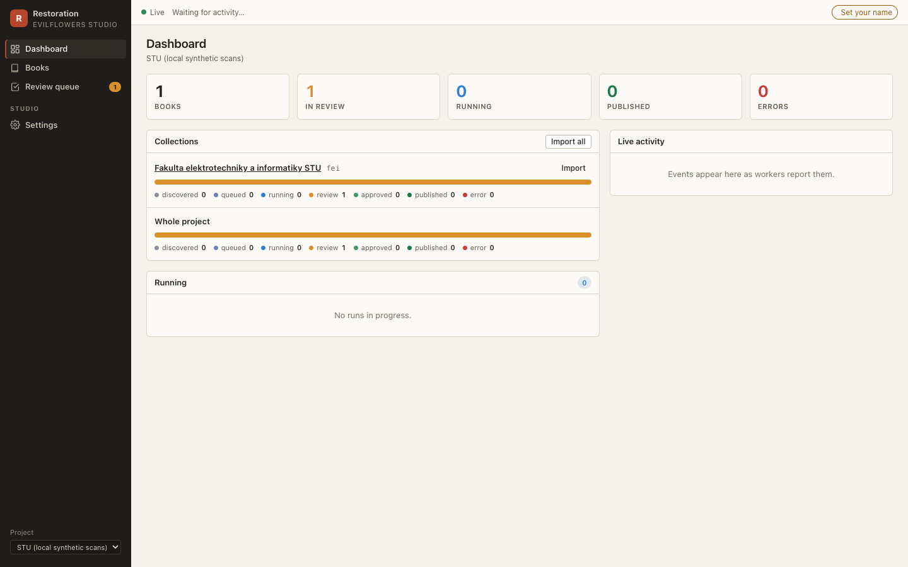
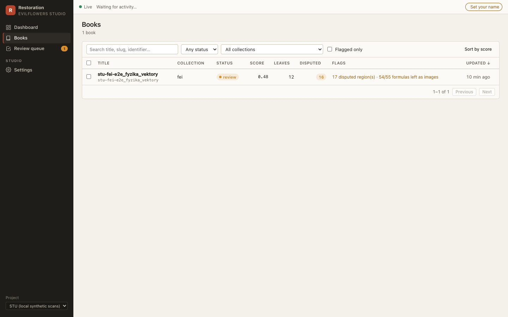
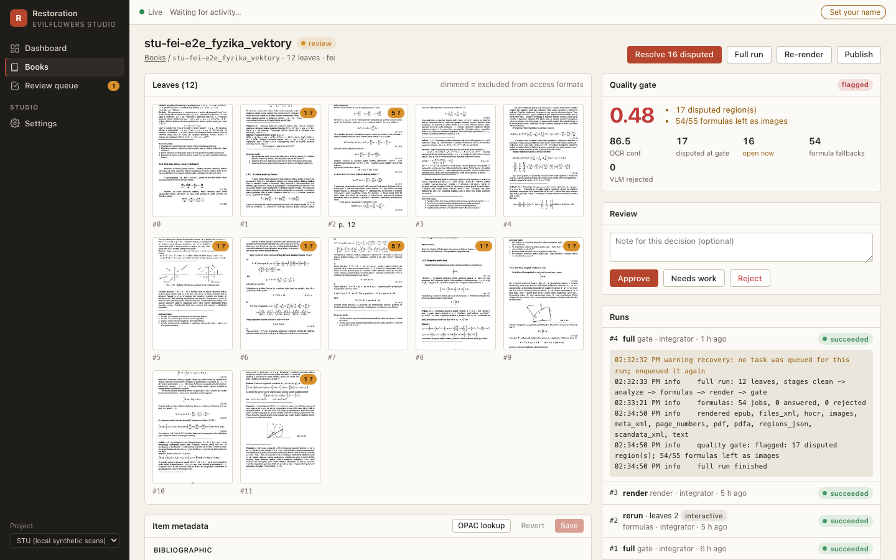
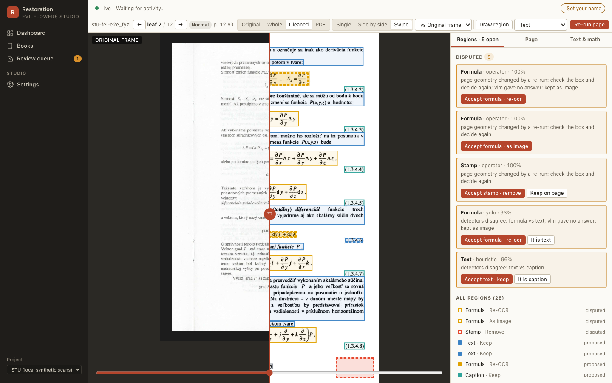
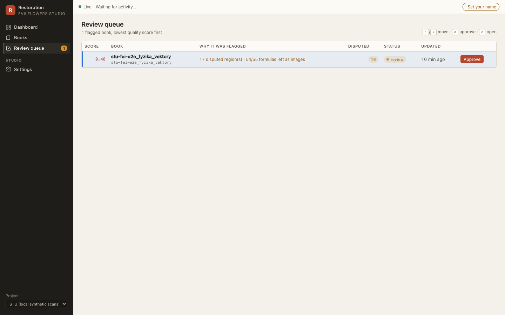

# Studio UI

The Restoration Studio's web UI is a single-page app (`frontend/`: React 18, TypeScript,
Vite, TanStack Query, OpenSeadragon, Annotorious) served by the studio API
(`studio/api`). It replaced the old server-rendered dashboard and viewer (`web/`, and
the `serve` command), which are gone. For the workflow, see the
[operator guide](studio.md).

```bash
pnpm --dir frontend build                                 # -> frontend/dist
evilflowers-digitalizer studio serve --port 8000          # API + SPA on http://127.0.0.1:8000
pnpm --dir frontend dev                                   # :5173 with hot reload, proxies /api
pnpm --dir frontend dev:mock                              # the whole UI on fixtures, no backend
```

## Screens

**Dashboard (`/`).** Per collection, a segmented bar of book statuses (discovered,
queued, running, review, approved, published, error) with import buttons; the runs in
progress with their stage bars; a live activity feed.



**Books (`/books`).** Filters for status, collection, flagged and free text, all kept in
the URL; sort by quality score; bulk actions (queue a run, approve).



**Book (`/books/:id`).** The leaf grid (page type badges, disputed markers, dimmed when
excluded from access), the quality gate with its flags and signals, review buttons, runs
with a live log and cancel, publication history, downloads (every artifact plus the IA
export zip), notes, paths, and the IA metadata form (`_meta.xml` field names; saves only
changed fields).



**Page studio (`/pages/:id`).** The core screen.

- **Layers:** original frame half, whole spread, cleaned page (Deep Zoom), PDF page.
- **Compare:** single, side by side or swipe, with synced viewports.
- **Regions:** rectangles coloured by kind, dashed when disputed. Draw, resize, relabel,
  set the action, add notes. Disputed regions are listed first with one-click accept or
  relabel.
- **Page:** IA leaf fields and the overrides for a re-run, with an optional OpenCV.js
  preview of crop, deskew and threshold.
- **Text & math:** editable OCR text per region; formula LaTeX with a live KaTeX preview.
- **Re-run page** on the interactive queue; the tile swaps when `page.updated` arrives.



**Review queue (`/review`).** Flagged books, lowest score first, keyboard driven.



**Settings (`/settings`).** The operator name (kept in the browser) and the project
preset, read-only and without secrets (`GET /api/v1/projects/{p}/config`).

## Keyboard

| where | keys |
|---|---|
| page studio | `t` text, `f` formula, `b` table, `p` picture, `s` stamp, `x` reject, `Enter` confirm, `←`/`→` leaf |
| review queue | `j`/`k` move, `a` approve, `o` open |

Shortcuts are off while typing in a field.

## Live updates

The SPA opens one `EventSource` on `GET /api/v1/events` and listens for each named
event type (`run.progress`, `page.updated`, `regions.updated`, `book.status`, …; see
`studio/events.py`). Events invalidate the matching TanStack Query caches; progress and
log lines patch the cached run directly. Polling every 15 s is used only while the
stream is down, and everything is re-read once on reconnect.

## Images and tiles

- Every page-media URL carries `?v=<page version>`, so a re-run never shows a cached tile.
- The cleaned layer is a Deep Zoom pyramid. The SPA opens `/api/v1/pages/{id}/dzi.xml?v=…`:
  with the `.xml` extension OpenSeadragon keeps the query string for the tile requests
  (`…/dzi_files/<level>/<col>_<row>.jpg?v=…`). The other layers are single renditions
  from `/api/v1/pages/{id}/image/{layer}?w=…`, cached under `<cache_dir>/viewer`.
- Files are served only from paths the database records or the artifact store derives,
  never from a path in the request.

## Operator identity

There is no authentication (VPN only). The `X-Operator` header carries the name from
Settings, percent-encoded because HTTP headers are Latin-1 and Slovak names are not;
the API decodes it.

## Processing database (classic batch CLI)

The classic `run-book` / `run-source` runner still records each book in the same database
through `db.Recorder` (fail-safe: a broken database logs a warning and the book carries
on). `evilflowers-digitalizer db upgrade` migrates it and `db import` backfills books
produced before it existed. The studio adds its own tables and columns in migration
`0002`; `studio migrate` applies the same Alembic history.
